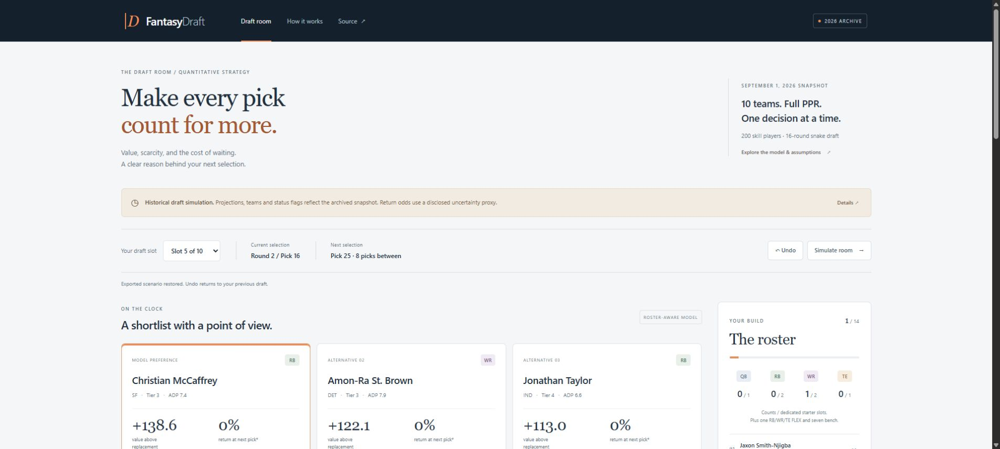
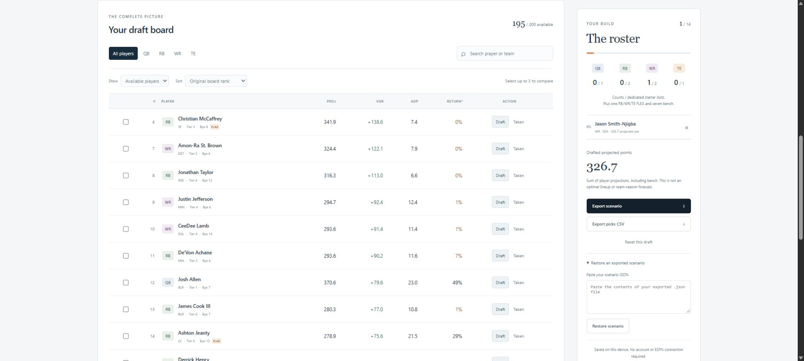

# FantasyDraft — The Draft Room

An interactive, local-first scenario tool for the existing public draft strategy.
It turns the archived 200-player board into a working product: roster-aware
recommendations, conditional-return estimates, comparisons, a draftable board,
snake-draft simulation, and portable scenarios.



## Run and deploy

Requires Node.js 22.12+ (or 20.19+).

```sh
npm ci
npm run dev
npm test
npm run build
npm run preview
```

The production artifact is `dist/`. Copy its contents to a static host. Vite uses
relative URLs, so it works at `/demos/fantasy-draft/`, a GitHub Pages repository
subpath, or a root URL without rebuilding. Use an HTTP server, not `file://`.

No ESPN account, API key, server, external font, analytics, or live data feed is
required. After static assets load, all draft interactions run in the browser.

## Workflow

1. Choose any of ten snake-draft slots. All picks refer to this local scenario.
2. Mark players **Taken** as the room selects them, or use **Simulate room** to fill
   earlier picks in archived market-ADP order. Simulation is explicit and reversible.
3. Inspect the three recommendations. Their VOR, next-tier gap, return estimate,
   roster fit and archived status explain the tradeoff.
4. Search/filter/sort the full board; select up to three players for a comparison.
5. **Draft** adds a player to your roster and advances to your next snake pick.
   **Undo**, **Reset** and per-player restore controls support alternate scenarios.
6. Export a scenario as JSON or all selections as CSV. Paste an exported JSON into
   **Restore an exported scenario** to continue it on another device. Restore checks
   the exact public-board provenance hash and validates all selections.

The session persists in versioned browser storage. If storage is unavailable, the
tool stays functional and suggests exporting. The original 16-round format is
retained, but this quantified board contains **200 skill players only** and supports
**14 skill selections**, with rounds 15–16 reserved for D/ST and kicker. It does not
invent omitted kicker or defense projections.

## Public data and source boundaries

`scripts/export_board.py` reads `draft_strategy/MASTER_BOARD.md` from immutable
public commit [`483c04a`](https://github.com/Ashwin-Iyer1/FantasyDraft/tree/483c04aefcef00e547542875bde98eed6b5e524f),
parses only its player rows, and writes `public/board.json`. The current repository
board can advance without changing this historical demo. It never reads `.env`, private
league snapshots, ESPN cookies, member records, account identifiers or team IDs.
The payload excludes the source document's personal league name and includes the
source revision, path and SHA-256 hash of the Git blob for reproducibility across
operating systems. The methodology link resolves to the same archived commit.

- Snapshot: **2026-09-01**, full PPR, ten teams, 16-round snake.
- Published fields: projection, VOR, positional rank/tier, team, bye, market ADP,
  ESPN ADP, FFC ADP, FantasyPros consensus rank, and archived status flag.
- Market ADP: original 75% ESPN / 25% FFC blend.
- ESPN projections/ADP are archived September 1 values; FantasyPros consensus was
  the August 28 DynastyProcess snapshot. Team and injury flags are historical too.

Rebuild the export and independent Python parity fixtures from a Git checkout
containing the source revision (a regular clone includes it):

```sh
python -m pip install -e .
cd web
npm run data
```

## Honest model adaptation

The original Python roster-fit weights, positional caps, progressive RB/WR
milestones, tier-drop calculation, early/late status penalty, and late-round upside
bonus are ported to TypeScript. The pick heuristic remains:

```text
return probability = P(available next pick) / P(available current pick)
urgency = (1 - return probability) × VOR drop to next available positional tier
pick score = VOR × roster fit + 0.8 × urgency - status penalty + upside bonus
```

The archived Markdown lacks FFC standard deviations and ESPN platform rank. The
workbench reconstructs an **uncertainty proxy**, using a base spread of
`clamp(0.16 × market ADP, 4, 16)` and the standard deviation of published ESPN ADP,
FFC ADP and ECR, combined in quadrature and clamped to `[3, 22]`. It similarly uses
the median of these three published ranks/ADPs for the late-upside proxy. This
adaptation is disclosed prominently. Return estimates are not calibrated real-world
odds and need not equal the original generated slot plans.

Unlike the static plan generator's assumed-availability filter, the interactive
board trusts the user's explicit taken/available state. This allows real reaches
and fallers to be explored. It is a decision heuristic, not a guaranteed optimal
roster or an independent projection ensemble. Roster projected-points totals include
bench players and are explicitly labeled as sums, not team-season forecasts.

## Verification

- 14 Vitest tests, including four Python parity fixtures, snake ordering, monotonic
  availability, roster fit/FLEX/caps, milestones, duplicate/unknown state rejection,
  simulation, exported units/provenance and public-data boundaries.
- Full deterministic 14-round drafts in all ten slots produce legal, populated
  starter positions. The numerical erfc approximation is checked against Python
  conditional returns to six decimal places and pick scores to five.
- Strict TypeScript checking and Vite production build.
- The existing six Python tests pass separately after the package is installed.
- Chrome QA: simulate prior picks, draft and advance the snake turn, search and
  comparison, reload persistence, reset/restore round trip, actual JSON download,
  and mobile layout without document overflow at 390 pixels. The player table has
  an intentional horizontally scrollable region on narrow screens.


